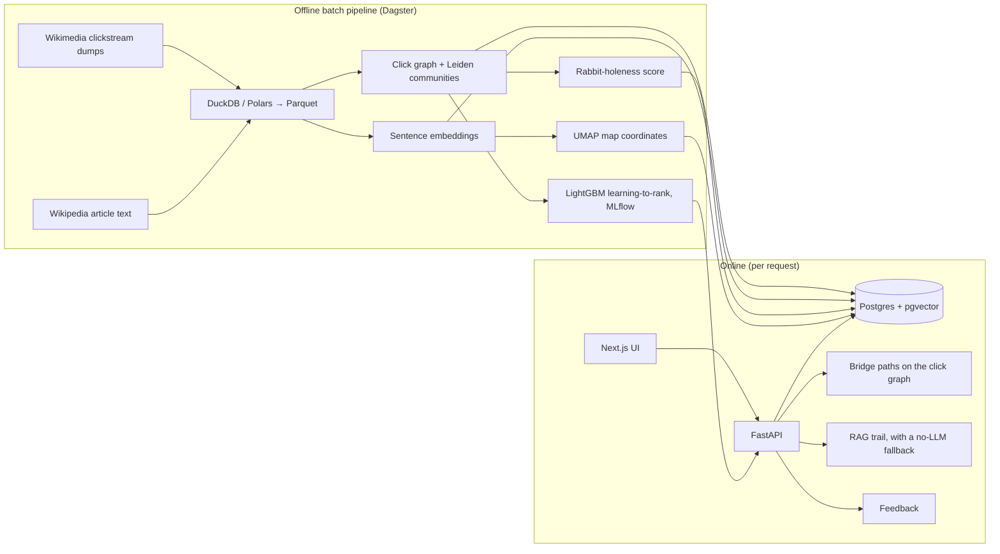

# Rabbit Hole Finder

> Tell it 3–5 things you love. It finds the Wikipedia **rabbit holes** waiting next door, measures how deep each one goes, shows the path real readers take to get there, and gives you a grounded reading trail to start with.

Most recommenders optimise for *more of the same*. This one optimises for **your next obsession**: a topic close enough to feel approachable, far enough to feel like a discovery, and deep enough to keep you busy for weeks. Every signal comes from how millions of people actually move through Wikipedia ([Wikimedia clickstream](https://meta.wikimedia.org/wiki/Research:Wikipedia_clickstream)), not from guesses.

**Status:** in active development. Phases 0–1 (tooling, data ingestion, EDA) are done; the rest is specified and being built phase by phase. See [Project status](#project-status).

---

## What it does (user flow)

1. **Enter your interests** as free text, e.g. *"mechanical keyboards"*, *"Byzantine Empire"*, *"Rust programming"*.
2. **Set the Surprise slider:** 0 = safe, adjacent picks; 1 = weird and wonderful.
3. **Get 5 rabbit holes**, each with:
   - a name and a one-line hook
   - a **Depth Meter** (0–100 rabbit-holeness score) with a breakdown of why
   - **Why this?**: the real navigation path from one of your interests into it ("readers of *Rust* go to *Memory safety*, then *Formal verification*, then the **Proof assistants** rabbit hole")
   - the top 5 articles inside it
4. **Open a rabbit hole** to get a **Trail**: 5–7 articles ordered from gentle to deep, each with a short "why read this", generated by retrieval-augmented generation over the article text. Every link comes from our own article table; the model cannot invent URLs.
5. **Rate it:** 👍 going down it / 👎 meh / 🤯 already obsessed.
6. **Explore the map:** a 2D map of every rabbit hole, with your interests glowing and your recommendations highlighted.

## How it works



### 1. Data
- **Clickstream:** monthly dumps of `(previous page, current page, count)` for English Wikipedia, about 34M rows a month. The pipeline finds the latest months itself and downloads three of them.
- **Temporal split, decided from day one:** the graph and all features come from the **oldest** month. The two later months are held out as *future* behaviour for training labels and evaluation, so the model is never scored on clicks it has already seen.
- **Per-article signals:** views, onward-click ratio (how often readers keep clicking), share of visits arriving from search versus from internal links.
- **Article text:** intro sections from the MediaWiki API (DEV mode; cached and rate-limited) or a streamed Hugging Face Wikipedia dump (FULL mode), split into ~300-word chunks for retrieval.
- **Two dataset sizes:** **DEV**, about 5,000 articles found by deterministic BFS from 25 seed topics across many domains (history, physics, cricket, Carnatic music, Zelda, sushi, Rust…), and **FULL**, every article with ≥ 1,000 monthly views (≈100k–300k).

### 2. Rabbit holes = communities in the click graph
Articles become nodes; edge weights are click counts in both directions. **Leiden** community detection (resolution tuned by a sweep over modularity, size distribution and embedding coherence) splits the graph into topic clusters. Each cluster is labelled with its most central article plus c-TF-IDF keywords. A notebook compares this with HDBSCAN on text embeddings.

### 3. Rabbit-holeness score (the novel part)
A rabbit hole is a topic where readers who enter **keep going and stay inside**. Clickstream lets us measure that directly:

| Feature | Meaning |
|---|---|
| **Expected depth** | Expected number of clicks a reader makes inside the cluster before leaving, from an **absorbing Markov chain**: with `Q` the in-cluster transition matrix and `π` the entry distribution, depth = `π · (I − Q)⁻¹ · 1` (solved with a sparse solver) |
| Stickiness | Share of clicks out of the cluster's articles that stay inside it |
| Onward ratio | Do readers keep clicking at all? |
| Breadth | Number of articles (log-scaled) |
| Content richness | How much there is to read |
| Discovery share | Found by wandering (internal links) rather than by searching |

The score is a weighted mean of z-scores, turned into a 0–100 percentile (the Depth Meter). There is no ground truth for "rabbit-holeness", so it is validated three ways: feature correlations, a face-validity report of the top and bottom 20 clusters, and 100 hand-labelled clusters (Spearman ρ).

### 4. Recommender
- **Seeds:** your free-text interests are embedded (`BAAI/bge-small-en-v1.5`) and matched to articles with pgvector.
- **Candidates:** every other cluster, with its semantic distance, graph distance (most-probable path, hubs penalised) and bridge strength.
- **v1, heuristic and explainable:** a "Goldilocks band" around a target distance set by the Surprise slider, multiplied by rabbit-holeness and bridge strength, then **MMR** re-ranking so the 5 picks are diverse.
- **v2, learning-to-rank:** **LightGBM LambdaRank** trained on a proxy label, namely where readers *actually* wandered in the held-out future months (3-step random walk mass, excluding direct links). Train/valid/test splits are by seed community, so no community leaks across splits. All runs are tracked in **MLflow**.

### 5. Grounded RAG trail
Retrieve the best chunks from the cluster's central articles, suggest a gentle-to-deep order, and have the LLM pick steps **only from the given article ids**. Code validates every step, attaches the URLs and falls back to a template trail if fewer than 5 steps survive. Without an API key the app runs entirely on the template trail.

### 6. Evaluation (`make eval`)
- **Systems:** random, popularity, nearest neighbour, heuristic v1 (with and without MMR), LTR v2, plus ablations.
- **Accuracy:** NDCG@5, Recall@10 and MRR against held-out future navigation.
- **Beyond accuracy:** novelty, intra-list diversity, catalogue coverage and serendipity, all with 95% bootstrap confidence intervals.
- **RAG:** 100% link validity, enforced in tests; faithfulness via an LLM judge calibrated on 30 hand-checked trails.
- **Human study:** 10–20 participants rate blind v1/v2 recommendations.

Results will go in [docs/RESULTS.md](docs/RESULTS.md) once these phases are built.

## Early findings (DEV data, clickstream 2026-07)

| | |
|---|---|
| Articles / link edges in DEV subset | 5,000 / 53,387 |
| Article text matched | 99.96% |
| Retrieval chunks | 6,023 |
| Median monthly views per article | ≈ 6,700 |
| Median onward-click ratio | 0.30 (readers click onward ~30% of the time) |
| Median share of visits from search | 33% |


More charts in [reports/figures/](reports/figures/) and the EDA notebook [notebooks/01_eda.py](notebooks/01_eda.py).

## Project status

| Phase | What | Status |
|---|---|---|
| 0 | Scaffold, tooling, CI | ✅ done |
| 1 | Clickstream ingestion, DEV subset, article text, chunks, data checks, EDA | ✅ done |
| 2 | Click graph and Leiden communities | ⏳ next |
| 3 | Embeddings, Postgres + pgvector, UMAP map | planned |
| 4 | Rabbit-holeness score and validation | planned |
| 5 | Recommender v1 and evaluation harness | planned |
| 6 | FastAPI service | planned |
| 7 | RAG trails | planned |
| 8 | Next.js frontend with deck.gl map | planned |
| 9 | FULL dataset and learning-to-rank v2 | planned |
| 10 | Deploy, user study, write-up | planned |

Detailed checklist: [docs/TASKS.md](docs/TASKS.md). Every design choice, including what was rejected and why: [docs/DECISIONS.md](docs/DECISIONS.md).

## Tech stack

| Layer | Tools |
|---|---|
| Data | Python 3.12, uv, **Polars**, **DuckDB**, Parquet |
| Orchestration | **Dagster** assets with data quality checks |
| Graph | python-igraph (Leiden), absorbing Markov chains with SciPy sparse solvers |
| ML | sentence-transformers, UMAP, **LightGBM LambdaRank**, **MLflow** |
| Storage | **PostgreSQL + pgvector**, SQLAlchemy, Alembic |
| Serving | **FastAPI**, Pydantic v2 |
| LLM | Provider interface with an LLM backend and a no-LLM template fallback |
| Frontend | Next.js, TypeScript, Tailwind, deck.gl |
| Quality | ruff, pyright (strict), pytest, pre-commit, GitHub Actions, Docker |

## Run it locally

**Prerequisites:** Git, Docker, Python 3.12+, [uv](https://docs.astral.sh/uv/), Node.js LTS and pnpm.

```bash
git clone https://github.com/Siddhartha121220/RabbitHole_Finder.git
cd RabbitHole_Finder
cp .env.example .env      # an LLM API key is optional
make setup                # install Python deps and git hooks
make up                   # start Postgres (pgvector) and MLflow in Docker
make lint && make test    # quality gates
make pipeline-dev         # build the DEV dataset (downloads ~1.5 GB of clickstream on first run)
```

| Command | Does |
|---|---|
| `make pipeline-dev` / `make pipeline` | Run the data/ML pipeline on DEV / FULL data |
| `make dagster-ui` | Open the Dagster UI to inspect assets and checks |
| `make lint` | ruff check, ruff format, pyright |
| `make test` | pytest |
| `make api`, `make web`, `make eval` | API, frontend, offline evaluation (coming in later phases) |

To open the EDA notebook: `uv --directory backend run marimo edit ../notebooks/01_eda.py`

## Repository layout

```
backend/src/rabbithole/
  ingest/      clickstream download + parse, subset, stats, article text, chunking
  graph/       graph build, communities, bridge paths        (Phase 2)
  embed/       embeddings + UMAP                             (Phase 3)
  scoring/     rabbit-holeness features + score              (Phase 4)
  recommend/   candidates, rankers, baselines                (Phase 5, 9)
  rag/, llm/   trail retrieval, generation, validation       (Phase 7)
  eval/        offline metrics + reports                     (Phase 5)
  db/, api/    Postgres models, FastAPI                      (Phase 3, 6)
  pipelines/   Dagster asset definitions
backend/tests/ pytest suite with tiny fixture data
notebooks/     marimo notebooks (EDA, community and score analysis)
reports/       generated reports and figures
docs/          PRD, architecture, data & ML spec, tasks, decisions, results
```

## Data, licence and ethics
- Wikipedia text is **CC BY-SA**; every article shown links back to Wikipedia.
- Clickstream data is published by the Wikimedia Foundation under **CC0**. It is aggregated and anonymised; this project never attempts re-identification.
- All Wikipedia API access uses an identifying User-Agent, at most 1 request per second, backoff on rate limits and on-disk caching.
- No user accounts and no personal data: feedback is tied only to an anonymous session id.
