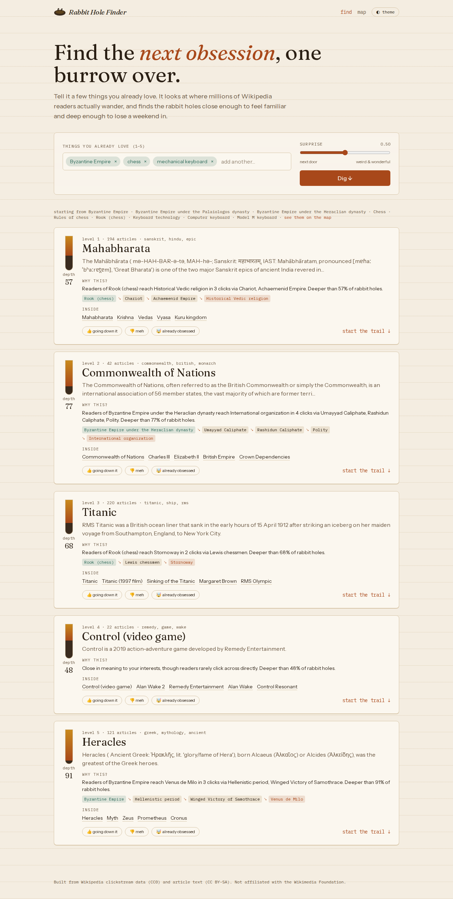
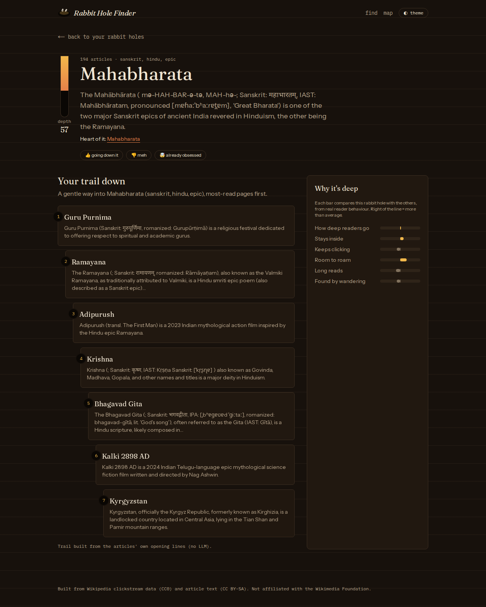
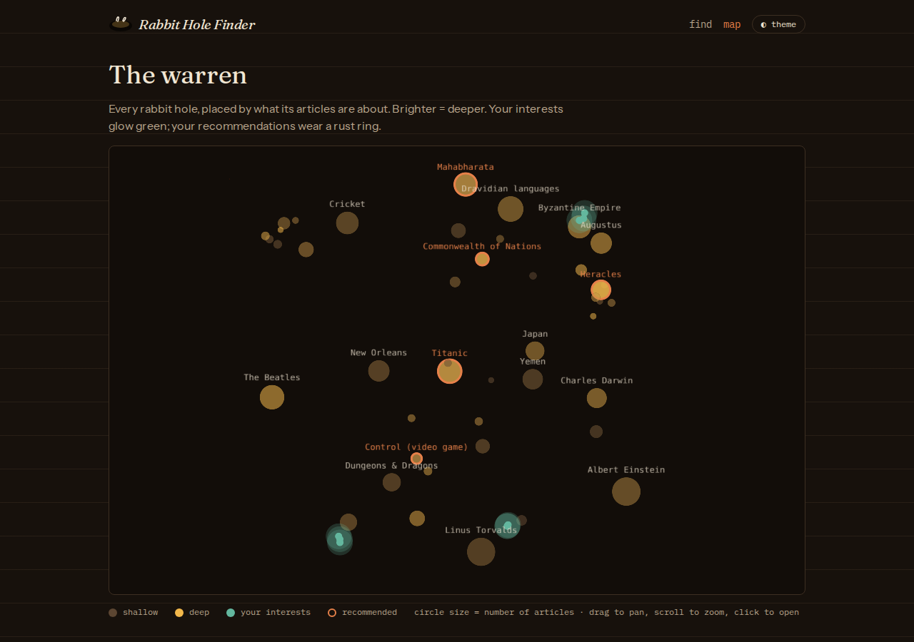
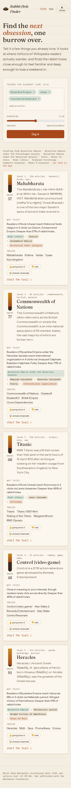
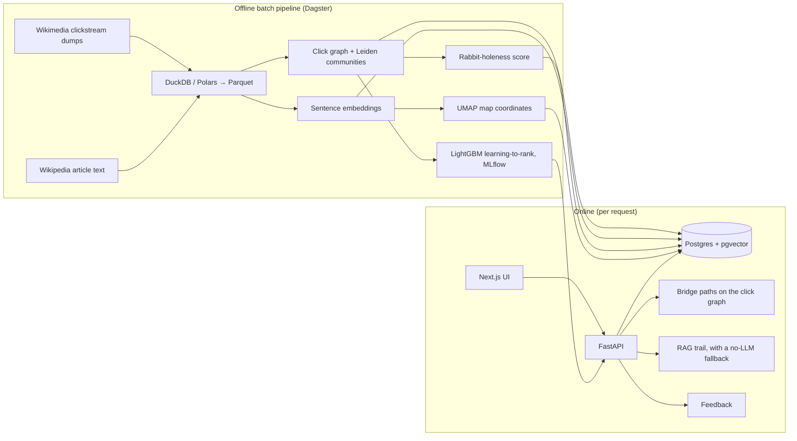
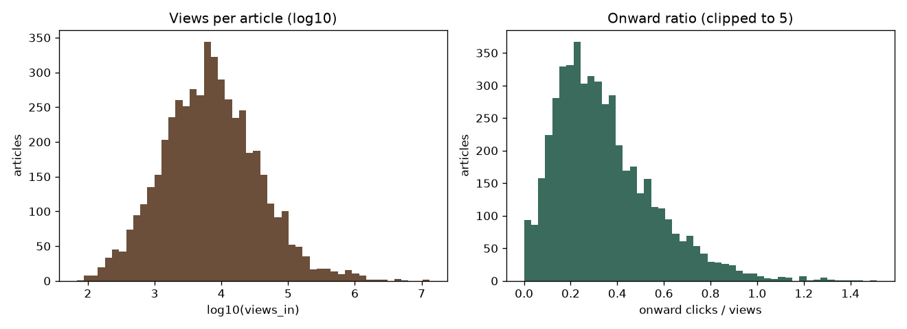
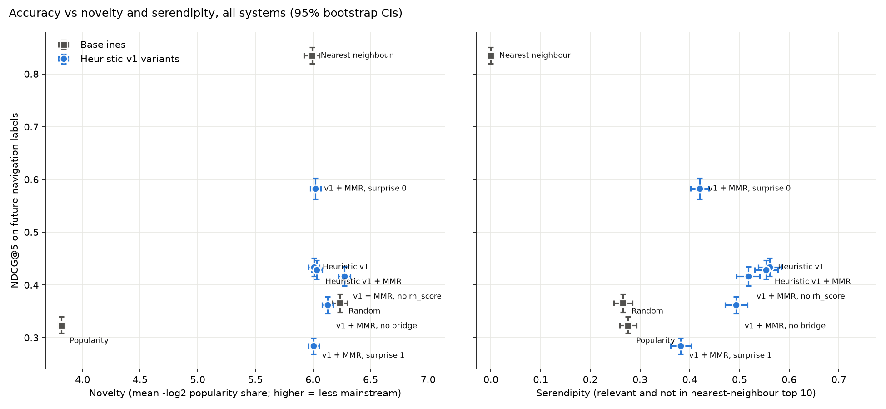

# Rabbit Hole Finder

> Tell it 3–5 things you love. It finds the Wikipedia **rabbit holes** waiting next door, measures how deep each one goes, shows the path real readers take to get there, and gives you a grounded reading trail to start with.

Most recommenders optimise for *more of the same*. This one optimises for **your next obsession**: a topic close enough to feel approachable, far enough to feel like a discovery, and deep enough to keep you busy for weeks. Every signal comes from how millions of people actually move through Wikipedia ([Wikimedia clickstream](https://meta.wikimedia.org/wiki/Research:Wikipedia_clickstream)), not from guesses.

**Status:** in active development. Phases 0–8 (tooling, data ingestion, EDA, click graph and communities, embeddings, vector database, map coordinates, rabbit-holeness score, recommender v1, offline evaluation, the FastAPI service, grounded RAG trails and the web app) are done (the paid LLM faithfulness run is pending); the rest is specified and being built phase by phase. See [Project status](#project-status).

---

## What it does (user flow)

1. **Enter your interests** as free text, e.g. *"mechanical keyboards"*, *"Byzantine Empire"*, *"Rust programming"*.
2. **Set the Surprise slider:** 0 = safe, adjacent picks; 1 = weird and wonderful.
3. **Get 5 rabbit holes**, each with:
   - a name and a one-line hook
   - a **Depth Meter** (0–100 rabbit-holeness score) with a breakdown of why
   - **Why this?**: the real navigation path from one of your interests into it ("readers of *Rust* go to *Memory safety*, then *Formal verification*, then the **Proof assistants** rabbit hole")
   - the top 5 articles inside it
4. **Open a rabbit hole** to get a **Trail**: 5–7 articles ordered from gentle to deep, each with a short "why read this", generated by retrieval-augmented generation over the article text. Every link comes from our own article table; the model cannot invent URLs.
5. **Rate it:** 👍 going down it / 👎 meh / 🤯 already obsessed.
6. **Explore the map:** a 2D map of every rabbit hole, with your interests glowing and your recommendations highlighted.

<table>
<tr>
<td width="50%"></td>
<td width="50%"></td>
</tr>
<tr>
<td></td>
<td></td>
</tr>
</table>

*Real screenshots against the DEV data (`reports/screens/`). Interests: Byzantine Empire, chess, mechanical keyboard.*

## How it works



### 1. Data
- **Clickstream:** monthly dumps of `(previous page, current page, count)` for English Wikipedia, about 34M rows a month. The pipeline finds the latest months itself and downloads three of them.
- **Temporal split, decided from day one:** the graph and all features come from the **oldest** month. The two later months are held out as *future* behaviour for training labels and evaluation, so the model is never scored on clicks it has already seen.
- **Per-article signals:** views, onward-click ratio (how often readers keep clicking), share of visits arriving from search versus from internal links.
- **Article text:** intro sections from the MediaWiki API (DEV mode; cached and rate-limited) or a streamed Hugging Face Wikipedia dump (FULL mode), split into ~300-word chunks for retrieval.
- **Two dataset sizes:** **DEV**, about 5,000 articles found by deterministic BFS from 25 seed topics across many domains (history, physics, cricket, Carnatic music, Zelda, sushi, Rust…), and **FULL**, every article with ≥ 1,000 monthly views (≈100k–300k).

### 2. Rabbit holes = communities in the click graph
Articles become nodes; edge weights are click counts in both directions. **Leiden** community detection splits the graph into topic clusters. The resolution is picked from a sweep by **modularity × topical coherence**: modularity alone gives a few giant clusters, coherence alone gives tiny ones. Each cluster is labelled with its most central article (the one members' readers most often move to) plus c-TF-IDF keywords. A notebook compares this with HDBSCAN on text vectors.

### 3. Rabbit-holeness score (the novel part)
A rabbit hole is a topic where readers who enter **keep going and stay inside**. Clickstream lets us measure that directly:

| Feature | Meaning |
|---|---|
| **Expected depth** | Expected number of pages a reader views inside the cluster before leaving, from an **absorbing Markov chain**: `Q[i,j]` = share of visits to *i* that continue to *j* (so stopping counts as leaving), `π` = where readers enter, depth = `π · (I − Q)⁻¹ · 1` (solved with a sparse solver, not by inverting) |
| Stickiness | Share of clicks out of the cluster's articles that stay inside it |
| Onward ratio | Do readers keep clicking at all? |
| Breadth | Number of articles (log-scaled) |
| Content richness | How much there is to read |
| Discovery share | Found by wandering (internal links) rather than by searching |

The score is a weighted mean of z-scores (expected depth counts double), turned into a 0–100 percentile (the Depth Meter). There is no ground truth for "rabbit-holeness", so it is validated three ways: feature correlations, a face-validity report of the top and bottom 20 clusters, and hand-labelled clusters rated blind (Spearman ρ, plus cross-validated ridge-learned weights as a comparison).

### 4. Recommender
- **Seeds:** your free-text interests are embedded (`BAAI/bge-small-en-v1.5`) and matched to articles with pgvector.
- **Candidates:** every other cluster, with its semantic distance, graph distance (most-probable path, hubs penalised) and bridge strength. The bridge path ends at the cluster's *entry article*; hubs such as *Europe* or *India*, which are linked from many different clusters, are never used as endpoints.
- **v1, heuristic and explainable:** a "Goldilocks band" around a target distance set by the Surprise slider, multiplied by rabbit-holeness and bridge strength, then **MMR** re-ranking so the 5 picks are diverse.
- **v2, learning-to-rank:** **LightGBM LambdaRank** trained on a proxy label, namely where readers *actually* wandered in the held-out future months (3-step random walk mass, excluding direct links). Train/valid/test splits are by seed community, so no community leaks across splits. All runs are tracked in **MLflow**.

### 5. Grounded RAG trail
Retrieve the best chunks from the cluster's central articles, suggest a gentle-to-deep order, and have the LLM pick steps **only from the given article ids**. Code validates every step, attaches the URLs and falls back to a template trail if fewer than 5 steps survive. Without an API key the app runs entirely on the template trail.

### 6. Evaluation (`make eval`)
- **Labels from the future:** for each test query, where readers actually walked within 3 clicks of the seeds in the two *later* months (direct links excluded), graded 0–3. Test queries come from seed communities held out by a 60/20/20 split.
- **Systems:** random, popularity, nearest neighbour, heuristic v1 (with and without MMR), LTR v2, plus ablations (no rh_score, no bridge) and a surprise sweep.
- **Accuracy:** NDCG@5, Recall@10 and MRR against held-out future navigation.
- **Beyond accuracy:** novelty, intra-list diversity, catalogue coverage and serendipity, all with 95% bootstrap confidence intervals, paired bootstrap tests, and every run logged to MLflow.
- **RAG:** 100% link validity, enforced in tests; faithfulness via an LLM judge calibrated on 30 hand-checked trails.
- **Human study:** 10–20 participants rate blind v1/v2 recommendations.

**Trail pipeline as built:**
1. **Retrieve:** the cluster's 10 most central and most-viewed articles, plus the bridge path; up to 12 passages by cosine similarity to your interests, at most 2 per article.
2. **Order:** gentle → deep, by views and the share of visits that come from search.
3. **Generate:** Claude (`LLM_MODEL`, default Haiku 5.5) returns schema-constrained JSON: article id + passage id + a one-line "why" per step.
4. **Validate and cache:** code keeps only steps whose ids were retrieved, joins URLs from the article table, falls back to the template trail if fewer than 5 survive, and caches the result.

Faithfulness is checked by a separate, stronger judge model plus a 30-trail human hand-check (`rabbithole judge-trails`).

Results so far: [docs/RESULTS.md](docs/RESULTS.md).

## Early findings (DEV data, clickstream 2026-07)

| | |
|---|---|
| Articles / link edges in DEV subset | 5,000 / 53,276 |
| Article text matched | 99.98% |
| Retrieval chunks (embedded, in pgvector) | 6,019 |
| Median monthly views per article | ≈ 6,700 |
| Median onward-click ratio | 0.30 (readers click onward ~30% of the time) |
| Median share of visits from search | 33% |
| Leiden resolution (from sweep) | 4 |
| Rabbit-hole candidates (communities with ≥ 8 articles) | 44, median 61 articles |
| Share of clicks that stay inside a community | 71% |



**Example communities found from clicks alone:** *Byzantine Empire* (Basil II, Justinian I, Alexios I Komnenos…), *Epic Cycle* (Little Iliad, Iliupersis, Aethiopis, Nostoi…), *The Backrooms* (liminal space, creepypasta, Kane Parsons…), *Keyboard layout*, and an SCP Foundation cluster (There Is No Antimemetics Division, information hazard, Lobotomy Corporation…; its central article is, amusingly, *Misanthropy*). See [reports/communities_sample.md](reports/communities_sample.md) and the sweep in [reports/leiden_sweep.md](reports/leiden_sweep.md).

**Choosing the resolution:** sentence embeddings are anisotropic (two random articles score ≈ 0.46 cosine), so coherence is measured as *lift over random pairs*. The score (modularity × coherence lift) is nearly flat between resolutions 2 and 4, so the rule picks the finest resolution within 5% of the best: smaller, more specific rabbit holes when the metric can't tell them apart.

**Leiden vs HDBSCAN:** the two overlap but differ (AMI ≈ 0.69). HDBSCAN on sentence embeddings discards ~17% of articles as noise, mostly the bridging ones, and wins on raw stickiness. On the same articles, Leiden's click-based clusters have clearly higher modularity (0.68 vs 0.58), so Leiden defines the rabbit holes. Details are in [notebooks/02_communities.py](notebooks/02_communities.py).

**Semantic search** ([reports/seed_search_probes.md](reports/seed_search_probes.md)): *"mechanical keyboard"* → Keyboard technology, Model M keyboard, Ergonomic keyboard; *"Byzantine"* → Byzantine Empire, Medieval Greek; *"conspiracy theories"* → Shadow government, Illuminati.

**Rabbit-holeness on DEV** ([reports/rh_extremes.md](reports/rh_extremes.md)):

| Deepest | Shallowest |
|---|---|
| The Beatles · Minoan civilization · Epic Cycle · Greek mythology (Heracles) · Ancient Rome (Augustus) · Byzantine Empire · The Legend of Zelda · Trojan War | Secret society · Keyboard layout · Costa Concordia disaster · Goalkeeper (football) · CRISPR |

Readers who enter Greek myth, Bronze Age Greece or Byzantium keep clicking inside. Readers who look up a keyboard layout read one page and leave (onward ratio 0.17). One honest wart: *1998 FIFA World Cup* ranks #2, partly because "content richness" uses page byte size and results tables are large. No two features correlate above 0.79 ([heatmap](reports/figures/03_rh_feature_correlation.png)). Human-label validation: pending.

**Recommender v1 vs baselines** ([reports/eval_2026-11-01.md](reports/eval_2026-11-01.md), 500 test queries):

| System | NDCG@5 [95% CI] | Serendipity |
|---|---|---|
| Random | 0.37 [0.35, 0.38] | 0.27 |
| Popularity | 0.32 [0.31, 0.34] | 0.28 |
| Nearest neighbour | **0.84** [0.82, 0.85] | 0.00 |
| Heuristic v1 + MMR | 0.43 [0.41, 0.45] | **0.55** |
| v1 + MMR, surprise 0 / 1 | 0.58 / 0.28 | 0.42 / 0.38 |

Nearest neighbour wins accuracy, as it should: the label is "where readers went next", and readers mostly go next door. v1 deliberately skips next door. It still beats random and popularity (p < 0.01), finds by far the most *relevant-but-not-obvious* clusters, and the Surprise slider trades accuracy for distance smoothly. Ablations: the click-path **bridge strength** carries the most signal (−0.07 NDCG without it); rh_score adds a small but significant +0.01. Caveat: 500 queries from only 9 test communities means the CIs are too narrow on DEV. Full discussion is in [docs/RESULTS.md](docs/RESULTS.md).



More charts in [reports/figures/](reports/figures/) and the EDA notebook [notebooks/01_eda.py](notebooks/01_eda.py).

**API** ([reports/api_latency.md](reports/api_latency.md)): `/recommend` answers in ≈ 100–175 ms median and ≈ 165–260 ms p95 on a laptop CPU, embedding included, against an 800 ms target. Example response for *Byzantine Empire + chess*: the *Titanic* rabbit hole, because "readers of *Rook (chess)* reach *Stornoway* in 2 clicks via *Lewis chessmen*. Deeper than 68% of rabbit holes."

| Endpoint | Does |
|---|---|
| `GET /health` | DB, encoder and catalog readiness |
| `POST /seeds/search` | free text → matching articles (autocomplete) |
| `POST /recommend` | 1–5 interests + surprise → rabbit holes with score breakdown, bridge path, top articles, "why" |
| `GET /rabbit-holes/{id}` | detail: about, central article, top articles, map position |
| `POST /rabbit-holes/{id}/trail` | grounded reading trail (Claude, or the template trail without a key), cached, rate-limited |
| `GET /map` | every rabbit hole with map position, size and score |
| `POST /feedback` | 👍 / 👎 / "obsessed" |

## Project status

| Phase | What | Status |
|---|---|---|
| 0 | Scaffold, tooling, CI | ✅ done |
| 1 | Clickstream ingestion, DEV subset, article text, chunks, data checks, EDA | ✅ done |
| 2 | Click graph and Leiden communities | ✅ done |
| 3 | Embeddings, Postgres + pgvector, UMAP map | ✅ done |
| 4 | Rabbit-holeness score and validation | ✅ done (human labels pending) |
| 5 | Recommender v1 and evaluation harness | ✅ done |
| 6 | FastAPI service | ✅ done |
| 7 | RAG trails | ✅ built (LLM faithfulness run pending an API key) |
| 8 | Next.js frontend with deck.gl map | ✅ done |
| 9 | FULL dataset and learning-to-rank v2 | ⏳ LTR v2 built and working on DEV (`rabbithole train-ltr`, `RECOMMENDER=v2`); FULL build on Kaggle in progress |
| 10 | Deploy, user study, write-up | planned |

Detailed checklist: [docs/TASKS.md](docs/TASKS.md). Every design choice, including what was rejected and why: [docs/DECISIONS.md](docs/DECISIONS.md).

## Tech stack

| Layer | Tools |
|---|---|
| Data | Python 3.12, uv, **Polars**, **DuckDB**, Parquet |
| Orchestration | **Dagster** assets with data quality checks |
| Graph | python-igraph (Leiden), absorbing Markov chains with SciPy sparse solvers |
| ML | sentence-transformers, UMAP, **LightGBM LambdaRank**, **MLflow** |
| Storage | **PostgreSQL + pgvector**, SQLAlchemy, Alembic |
| Serving | **FastAPI**, Pydantic v2 |
| LLM | Provider interface with an LLM backend and a no-LLM template fallback |
| Frontend | Next.js 16 (App Router), React 19, TypeScript strict, Tailwind 4, deck.gl 9, Playwright |
| Quality | ruff, pyright (strict), pytest, pre-commit, GitHub Actions, Docker |

## Run it locally

**Prerequisites:** Git, Docker, Python 3.12+, [uv](https://docs.astral.sh/uv/), Node.js LTS and pnpm.

```bash
git clone https://github.com/Siddhartha121220/RabbitHole_Finder.git
cd RabbitHole_Finder
cp .env.example .env      # an LLM API key is optional
make setup                # install Python + frontend deps and git hooks
make up                   # start Postgres (pgvector) and MLflow in Docker
make lint && make test    # quality gates
make pipeline-dev         # build the DEV dataset (downloads ~1.5 GB of clickstream on first run)
make api                  # terminal 1: API on http://localhost:8000
make web                  # terminal 2: open http://localhost:3000
```

| Command | Does |
|---|---|
| `make pipeline-dev` / `make pipeline` | Run the data/ML pipeline on DEV / FULL data, ending with a load into Postgres |
| `make load` | Load already-built Parquet (e.g. a Kaggle bundle) into Postgres; no rebuild |
| `rabbithole pack --out DIR` / `rabbithole unpack DIR` | Bundle / install a finished pipeline run between machines |
| `make migrate` | Apply database migrations (the pipeline also does this) |
| `make dagster-ui` | Open the Dagster UI to inspect assets and checks |
| `make lint` | ruff check, ruff format, pyright |
| `make test` | pytest |
| `uv --directory backend run rabbithole label-communities --n 100` | Rate communities 1–7, blind to the score, with a short description of each community and article (resumable) |
| `make eval` | Offline evaluation of all systems → `reports/eval_<date>.md` + chart, logged to MLflow (http://localhost:5000) |
| `make api` | FastAPI on http://localhost:8000, interactive docs at `/docs` |
| `uv --directory backend run rabbithole judge-trails --n 50` | Generate and LLM-judge 50 trails → `reports/trail_eval.md` + hand-check sheet (needs `ANTHROPIC_API_KEY`, costs ≈ $1; over 200 trails needs `--yes`) |
| `uv --directory backend run rabbithole judge-trails --agreement` | Judge vs your hand-check verdicts (agreement, Cohen's kappa) |
| `uv --directory backend run python ../scripts/latency.py` | p50/p95 of `/recommend` over 100 random queries (API must be running) → `reports/api_latency.md` |
| `make web` | Next.js dev server on http://localhost:3000 (needs `make api`) |
| `make api-types` | Regenerate `frontend/openapi.json` and the typed API client after changing API schemas |
| `cd frontend && pnpm test:e2e` | Playwright smoke tests (API mocked) |
| `cd frontend && pnpm build && pnpm screens` | Full flow against the real API → `reports/screens/*.png` |

To open a notebook: `uv --directory backend run marimo edit ../notebooks/01_eda.py`

### Build the FULL dataset on Kaggle (2× T4 GPUs)
FULL (≈ 654k articles at ≥ 1,000 monthly views, 11M link edges) is built by the same Dagster pipeline on a free Kaggle GPU notebook, then installed locally:
1. Kaggle → New Notebook → *File → Import Notebook* → [`kaggle/rabbithole_full_build.ipynb`](kaggle/rabbithole_full_build.ipynb). Accelerator **GPU T4 ×2**, Internet **on**, then *Save Version → Save & Run All*. It clones this repo, runs every asset except the Postgres load (embedding on both GPUs, fp16), and packs the result with `rabbithole pack`.
2. Download the notebook's output (`kaggle kernels output <user>/<slug> -p ~/Downloads/rabbithole_full`).
3. `uv --directory backend run rabbithole unpack ~/Downloads/rabbithole_full/rabbithole_full`, then `DATASET_MODE=full make load` (bulk `COPY` load into Postgres).

### Optional: embed on a free GPU only (Colab / Kaggle)
Embedding runs on CPU by default (DEV takes ~15 minutes; FULL can take hours). To use a GPU instead:
1. Run the pipeline once. It writes the inputs to `data/export/articles_texts.parquet` and `data/export/chunks_texts.parquet`, with columns `id` and `text`.
2. Upload them to a GPU notebook and run:
   ```python
   import polars as pl
   from sentence_transformers import SentenceTransformer
   model = SentenceTransformer("BAAI/bge-small-en-v1.5", device="cuda")
   for name in ["articles", "chunks"]:
       df = pl.read_parquet(f"{name}_texts.parquet")
       vecs = model.encode(df["text"].to_list(), batch_size=256, normalize_embeddings=True)
       df.select("id").with_columns(pl.Series("embedding", vecs)).write_parquet(f"{name}_embeddings.parquet")
   ```
3. Put the two `*_embeddings.parquet` files in `data/import/` and re-run the pipeline. It uses them instead of embedding locally.

## Repository layout

```
backend/src/rabbithole/
  ingest/      clickstream download + parse, subset, stats, article text, chunking
  graph/       click graph, Leiden communities, labels, pruned serving graph
  embed/       sentence embeddings, UMAP map, semantic search
  scoring/     rabbit-holeness features (absorbing Markov chain), score, labels
  recommend/   catalog, seeds, candidates + bridge paths, v1 ranker, baselines (Phase 5; LTR in 9)
  rag/, llm/   trail retrieval + ordering + validation; Anthropic / template providers (Phase 7)
  eval/        future-walk labels, metrics, bootstrap, report + MLflow (Phase 5)
  db/          Postgres models, idempotent loader (migrations in backend/alembic/)
  api/         FastAPI app, routes, schemas, JSON logging, rate limit (Phase 6)
  pipelines/   Dagster asset definitions
backend/tests/ pytest suite with tiny fixture data
frontend/      Next.js app: pages / (find), /hole/[id] (detail + trail), /map; e2e/ Playwright
notebooks/     marimo notebooks (EDA, community and score analysis)
scripts/       one-off tools (API latency check)
reports/       generated reports and figures
docs/          PRD, architecture, data & ML spec, tasks, decisions, results
```

## Data, licence and ethics
- Wikipedia text is **CC BY-SA**; every article shown links back to Wikipedia.
- Clickstream data is published by the Wikimedia Foundation under **CC0**. It is aggregated and anonymised; this project never attempts re-identification.
- All Wikipedia API access uses an identifying User-Agent, at most 1 request per second, backoff on rate limits and on-disk caching.
- No user accounts and no personal data: feedback is tied only to an anonymous session id.
