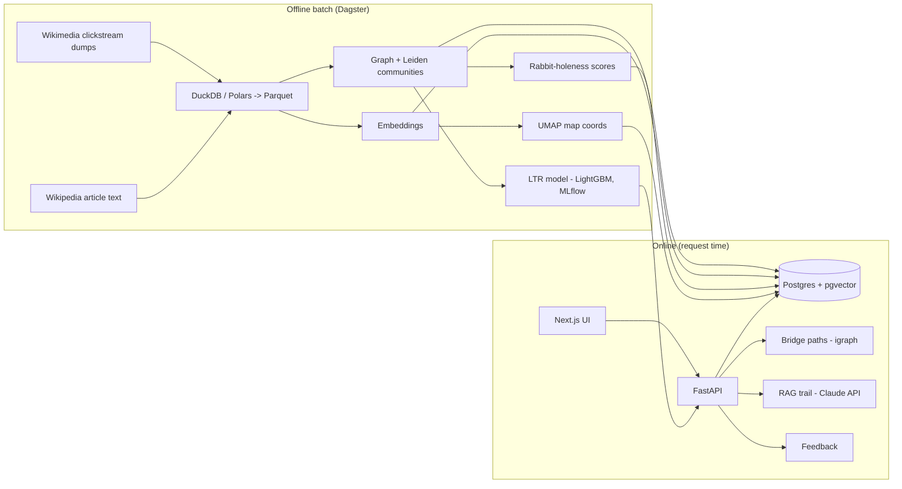

# Architecture — Rabbit Hole Finder

## 1. Overview



Offline pipeline produces everything expensive. The API only does lookups, small graph searches, ranking and (cached) LLM calls.

## 2. Tech stack (and why companies care)

| Layer | Choice | Why |
|---|---|---|
| Language / env | Python 3.12+, **uv** | Fast modern packaging; replacing pip/poetry in industry |
| Lint / types | **ruff**, **pyright** | Industry standard quality gates |
| Dataframes | **Polars**, **DuckDB**, Parquet | Modern, fast, laptop-scale big data; SQL skills on display |
| Orchestration | **Dagster** (software-defined assets) | Data-engineering orchestration used by product companies; asset lineage UI is great in demos |
| Graph | **python-igraph** (Leiden), NetworkX only for small utilities | igraph scales to millions of edges in memory |
| Embeddings | **sentence-transformers**, default `BAAI/bge-small-en-v1.5` (384-d, CPU friendly) | Configurable via `EMBEDDING_MODEL`; larger model optional on GPU (Colab/Kaggle) |
| Dim. reduction / clustering | **umap-learn**, HDBSCAN (from scikit-learn) for comparison | Map view and cluster sanity checks |
| Ranking model | **LightGBM** LambdaRank | Learning-to-rank is a classic interview topic |
| Experiment tracking | **MLflow** | Most common tracking tool in Indian DS job posts |
| Database | **PostgreSQL 16+ with pgvector** | One DB for relational + vector search; widely used |
| ORM / migrations | **SQLAlchemy 2.x**, **Alembic**, psycopg 3 | Standard |
| API | **FastAPI**, **Pydantic v2**, Uvicorn | Standard Python ML serving stack |
| LLM | **Anthropic Claude API** (`anthropic` SDK), model from `LLM_MODEL` | Behind a small provider interface so it can be swapped; template fallback when no key |
| Frontend | **Next.js** (App Router) + TypeScript + Tailwind + **deck.gl** (map) | Modern, deployable, impressive demo |
| Containers | **Docker** + docker compose | Required for deploy and reproducibility |
| CI | **GitHub Actions** | lint, types, tests, frontend build |
| Deploy (default) | API container on Render/Fly.io/Railway; DB on Neon or Supabase (both support pgvector); frontend on Vercel | Free/cheap tiers. Ask user before creating any cloud resource. |

Any library not in this table needs user approval (see CLAUDE.md).

## 3. Repository layout
```
rabbithole/
├── CLAUDE.md
├── README.md
├── Makefile
├── docker-compose.yml          # postgres+pgvector, mlflow (api/web optional profiles)
├── .env.example
├── .github/workflows/ci.yml
├── backend/
│   ├── pyproject.toml
│   ├── alembic/
│   ├── src/rabbithole/
│   │   ├── config.py           # pydantic-settings
│   │   ├── logging.py
│   │   ├── ingest/             # clickstream download+parse, article text fetch
│   │   ├── graph/              # graph build, pruning, communities, bridge paths
│   │   ├── embed/              # embedding + UMAP
│   │   ├── scoring/            # rabbit-holeness features + score
│   │   ├── recommend/          # candidate gen, heuristic ranker, LTR ranker, baselines
│   │   ├── rag/                # chunking, retrieval, prompt, generation, validation
│   │   ├── llm/                # provider interface: anthropic + template fallback
│   │   ├── eval/               # offline metrics, eval runner, report writer
│   │   ├── db/                 # SQLAlchemy models, session, loaders
│   │   ├── api/                # FastAPI app, routers, schemas, deps
│   │   └── pipelines/          # Dagster assets/definitions
│   └── tests/ (+ fixtures/)
├── frontend/                   # Next.js app
├── notebooks/                  # EDA and analysis (marimo or Jupyter), outputs stripped
├── reports/                    # generated eval reports + figures (committed)
├── data/                       # gitignored: raw/, interim/, processed/
└── docs/ (PRD, ARCHITECTURE, DATA_AND_ML, TASKS, DECISIONS, RESULTS)
```

## 4. Data storage

### Parquet (in `data/processed/`, produced by Dagster)
- `articles.parquet` — `article_id, title, views_in, onward_clicks, onward_ratio, search_entry_share`
- `edges.parquet` — `src_id, dst_id, n, p` (p = transition probability src→dst)
- `edges_pruned.parquet` — top-k outgoing edges per article (k=10 default) for serving
- `communities.parquet`, `article_text.parquet` (lead section), `chunks.parquet`

### Postgres tables
```
articles(id PK, title, url, views, community_id FK, lead_text, embedding vector(384), umap_x, umap_y)
communities(id PK, label, hook, size, rh_score, rh_features JSONB, centroid vector(384),
            umap_x, umap_y, top_article_ids INT[])
chunks(id PK, article_id FK, ord, text, embedding vector(384))
trails(id PK, community_id, seed_key TEXT, model, payload JSONB, created_at)   -- cache
feedback(id PK, session_id, community_id, seed_titles TEXT[], surprise REAL,
         rating TEXT CHECK (rating IN ('up','down','obsessed')), created_at)
pipeline_runs(id PK, dataset_mode, clickstream_months, started_at, finished_at, stats JSONB)
```
Use HNSW indexes on embedding columns (cosine). Vector dimension must follow the configured model; read it from the model at load time.

### In-memory at API startup
The pruned edge list is loaded into a SciPy sparse matrix (multi-source Dijkstra via `scipy.sparse.csgraph`) for bridge-path search, together with community centroids, scores and article→community ids: the same `Catalog` object the offline evaluation uses. *(Phase 5/6: igraph replaced by csgraph, which does multi-source shortest paths with predecessors in one C call.)* Memory budget for the deployed instance: **≤ 1 GB total**. If the FULL graph does not fit, precompute per-community entry articles and restrict search to 3 hops.

## 5. API (FastAPI, all JSON, Pydantic v2 schemas)

| Method | Path | Purpose |
|---|---|---|
| GET | `/health` | DB + model loaded check |
| POST | `/seeds/search` | `{query}` → top matching articles (for autocomplete) |
| POST | `/recommend` | `{interests: str[1..5], surprise: float 0..1, k: int=5, session_id?}` → rabbit holes with `rh_score`, `rh_breakdown`, `bridge_path` (list of titles+urls), `top_articles`, `why` |
| GET | `/rabbit-holes/{id}` | community detail |
| POST | `/rabbit-holes/{id}/trail` | `{seed_titles}` → RAG trail (cached in `trails`) |
| GET | `/map` | all communities with umap coords, size, score (compact payload, gzip) |
| POST | `/feedback` | store rating |

Rules: CORS restricted to the frontend origin; request validation via Pydantic; basic rate limiting on the trail endpoint (in-process token bucket is fine); OpenAPI docs enabled.

## 6. LLM provider interface
```python
class LLMProvider(Protocol):
    def generate_trail(self, request: TrailRequest, context: list[RetrievedChunk]) -> TrailDraft: ...
```
- `AnthropicProvider` — uses the official `anthropic` SDK, model from `LLM_MODEL`, structured JSON output validated with Pydantic, temperature low, timeout + 1 retry. *(Phase 7: current models reject non-default sampling parameters, so determinism comes from the JSON schema and `effort: low` instead of temperature. Refusals and invalid output return an empty draft, which falls back to the template.)*
- `TemplateProvider` — no LLM; builds the trail from the ranked article list and the first sentence of each lead. Used when `ANTHROPIC_API_KEY` is empty and in all tests.

## 7. Frontend
Pages: `/` (input + results), `/hole/[id]` (detail + trail), `/map` (full map). Components: InterestInput (with autocomplete via `/seeds/search`), SurpriseSlider, RabbitHoleCard (DepthMeter, BridgePath, feedback buttons), TrailView (ordered steps with citations), MapView (deck.gl ScatterplotLayer, user seeds highlighted, hover tooltips). Must work at phone width. Light and dark theme. Loading and error states for every API call. Use the `frontend-design` skill if available for visual direction; aim for a distinctive "descending into a burrow" look, not a generic dashboard.

## 8. Observability
- Structured JSON logs with request id and latency.
- Log every recommendation request (interests hash, surprise, returned ids) to a `recommendation_log` table (or JSONL log file) for later analysis; no personal data.
- MLflow for all offline runs (params, metrics, artifacts incl. eval report).

## 9. Security & ethics
- Secrets only via env vars. `.env` gitignored.
- Wikipedia content is CC BY-SA: show attribution in the footer and link every article.
- Clickstream is aggregated and anonymized by Wikimedia; do not attempt to re-identify anything.
