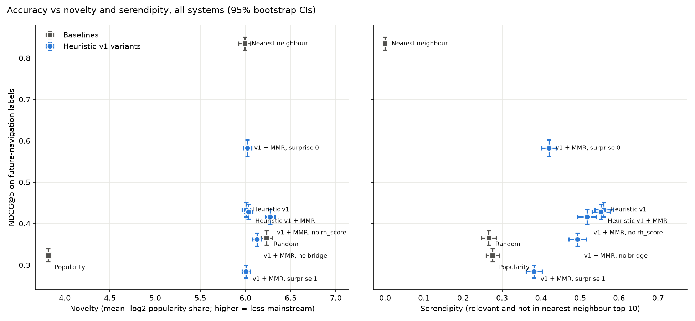

# Results

## Offline evaluation

### v1 vs baselines — DEV, 2026-11-01 ([full report](../reports/eval_2026-11-01.md))

Graph and features come from **2026-07**. Labels come only from **2026-08 + 2026-09**: where readers walked within 3 clicks of the seed articles, excluding pages one click away (graded 0–3). 500 test queries, 9 held-out seed communities, 44 candidate communities. Mean [95% bootstrap CI].

| System | NDCG@5 | Recall@10 | MRR | Serendipity | Diversity | Novelty |
|---|---|---|---|---|---|---|
| Random | 0.366 [0.348, 0.383] | 0.241 | 0.649 | 0.266 | 0.236 | 6.24 |
| Popularity | 0.324 [0.309, 0.340] | 0.277 | 0.525 | 0.276 | 0.237 | 3.82 |
| **Nearest neighbour** | **0.835** [0.819, 0.850] | **0.425** | **0.978** | 0.000 | 0.149 | 5.99 |
| Heuristic v1 | 0.434 [0.416, 0.451] | 0.237 | 0.822 | **0.561** | 0.215 | 6.01 |
| Heuristic v1 + MMR | 0.429 [0.411, 0.447] | 0.235 | 0.822 | 0.554 | 0.220 | 6.03 |
| v1 + MMR, no rh_score | 0.416 [0.399, 0.434] | 0.219 | 0.825 | 0.518 | 0.220 | 6.28 |
| v1 + MMR, no bridge | 0.362 [0.346, 0.378] | 0.217 | 0.709 | 0.494 | 0.222 | 6.13 |
| v1 + MMR, surprise 0 | 0.583 [0.563, 0.603] | 0.331 | 0.869 | 0.420 | 0.201 | 6.02 |
| v1 + MMR, surprise 1 | 0.284 [0.269, 0.299] | 0.158 | 0.648 | 0.382 | 0.234 | 6.01 |

**What this says**

- **Nearest neighbour wins accuracy by a wide margin, and that is expected.** The label is "where readers went next", and readers mostly go next door. v1 is *designed* not to recommend next door: its Goldilocks band targets the middle of the distance range (surprise 0.5). It skips the most obvious neighbours on purpose, which is also why its serendipity (relevant **and** not in NN's top 10) is 0.55 against NN's 0 by construction.
- **v1 beats random and popularity** on NDCG@5 (paired bootstrap: +0.063 and +0.105, both p < 0.01) and on MRR. It finds communities readers really reach, at a distance NN would not offer.
- **The Surprise slider behaves as a real dial.** Surprise 0 → NDCG 0.58; 0.5 → 0.43; 1 → 0.28. Accuracy on "next door" labels falls as the band moves outward. This is the trade-off the user controls.
- **Ablations:** bridge strength carries the most signal (removing it: −0.066 NDCG, p < 0.001). It is the one feature built from actual click paths. rh_score adds a small but significant +0.012 (p ≈ 0.01). It is not trying to predict next clicks, so a small effect on this label is fine; its job is depth, not proximity.
- **MMR costs a little accuracy for a little diversity** (−0.005 NDCG, +0.005 diversity). It is significant but tiny on DEV, where 44 communities leave little room to diversify. Kept for the product; re-check on FULL.
- **Novelty barely separates systems on DEV** (only Popularity stands out), because DEV communities have similar view totals. Expect more spread on FULL.

**Caveats (honest list)**
- The label is a **proxy** for "fell into a rabbit hole": future click mass, which favours nearby, well-linked communities. It structurally rewards NN.
- 500 queries come from only **9 test communities**, so queries are clustered. The bootstrap CIs resample queries and are therefore **too narrow**; differences that are small relative to CI width should not be trusted. FULL data (hundreds of communities) fixes this.
- DEV is a 5,000-article BFS around 25 unrelated seeds, so some "bridges" are odd (keyboards → Nintendo Switch → Titanic). FULL density should give more natural paths.

### LTR v2 — DEV smoke run, 2026-11-11 ([full report](../reports/eval_2026-11-11.md))
LightGBM lambdarank reaches NDCG@5 0.95 [0.94, 0.96] against 0.43 for heuristic v1 + MMR (paired diff +0.20 with the band and MMR). On 44 communities this is near saturation, so it only shows the pipeline works; the accuracy-for-novelty trade (novelty 5.6 vs 6.0, serendipity 0.22 vs 0.55 without the band) is the pattern to check on FULL. The real table replaces this once FULL is built.

## Rabbit-holeness validation
_TBD (Phase 4)._

## RAG trail evaluation
- **Link validity: 100% by construction and in tests.** The LLM never sees URLs; invented ids, duplicates and cross-article chunk citations are dropped (`tests/test_api.py`).
- **Faithfulness (LLM judge) and judge-vs-human agreement: pending.** Run `rabbithole judge-trails --n 50` (needs `ANTHROPIC_API_KEY`, ≈ $1), then fill `reports/trail_check.csv` and run `rabbithole judge-trails --agreement`.

## Human study
_TBD (Phase 10)._
