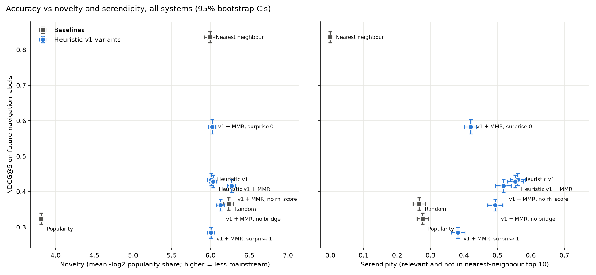

# Offline evaluation — 2026-11-01 (DEV)

Feature month 2026-07; labels from 2026-08,2026-09 (3-step random walk, 1-hop mass excluded, graded 0-3). 500 test queries from 9 held-out seed communities; 44 eligible communities. Mean [95% bootstrap CI, 1000 resamples]. Relevant = grade >= 2. Top 5 shown to the user; recall/MRR use the top 10.

| System | ndcg@5 | recall@10 | mrr | novelty | diversity | serendipity | coverage |
|---|---|---|---|---|---|---|---|
| Random | 0.366 [0.348, 0.383] | 0.241 [0.232, 0.249] | 0.649 [0.618, 0.680] | 6.236 [6.173, 6.297] | 0.236 [0.233, 0.238] | 0.266 [0.248, 0.284] | 1.000 [1.000, 1.000] |
| Popularity | 0.324 [0.309, 0.340] | 0.277 [0.269, 0.285] | 0.525 [0.496, 0.553] | 3.815 [3.804, 3.826] | 0.237 [0.237, 0.237] | 0.276 [0.259, 0.293] | 0.136 [0.136, 0.136] |
| Nearest neighbour | 0.835 [0.819, 0.850] | 0.425 [0.415, 0.435] | 0.978 [0.967, 0.988] | 5.994 [5.924, 6.058] | 0.149 [0.145, 0.153] | 0.000 [0.000, 0.000] | 0.955 [0.932, 0.955] |
| Heuristic v1 | 0.434 [0.416, 0.451] | 0.237 [0.230, 0.245] | 0.822 [0.796, 0.849] | 6.011 [5.964, 6.056] | 0.215 [0.213, 0.218] | 0.561 [0.538, 0.584] | 0.955 [0.909, 0.955] |
| Heuristic v1 + MMR | 0.429 [0.411, 0.447] | 0.235 [0.228, 0.243] | 0.822 [0.796, 0.850] | 6.034 [5.989, 6.079] | 0.220 [0.218, 0.223] | 0.554 [0.531, 0.577] | 0.955 [0.886, 0.955] |
| v1 + MMR, no rh_score | 0.416 [0.399, 0.434] | 0.219 [0.212, 0.226] | 0.825 [0.797, 0.853] | 6.275 [6.224, 6.326] | 0.220 [0.218, 0.222] | 0.518 [0.494, 0.541] | 1.000 [1.000, 1.000] |
| v1 + MMR, no bridge | 0.362 [0.346, 0.378] | 0.217 [0.210, 0.225] | 0.709 [0.679, 0.738] | 6.128 [6.081, 6.175] | 0.222 [0.220, 0.224] | 0.494 [0.471, 0.516] | 0.955 [0.909, 0.955] |
| v1 + MMR, surprise 0 | 0.583 [0.563, 0.603] | 0.331 [0.322, 0.339] | 0.869 [0.845, 0.893] | 6.023 [5.979, 6.069] | 0.201 [0.199, 0.204] | 0.420 [0.402, 0.438] | 0.886 [0.841, 0.886] |
| v1 + MMR, surprise 1 | 0.284 [0.269, 0.299] | 0.158 [0.150, 0.166] | 0.648 [0.614, 0.678] | 6.005 [5.962, 6.052] | 0.234 [0.231, 0.237] | 0.382 [0.362, 0.403] | 0.932 [0.886, 0.932] |

## Paired bootstrap, NDCG@5 (same queries)

| A vs B | mean diff [95% CI] | p |
|---|---|---|
| Heuristic v1 + MMR vs Nearest neighbour | -0.406 [-0.427, -0.386] | 0.000 |
| Heuristic v1 + MMR vs Popularity | +0.105 [+0.087, +0.124] | 0.000 |
| Heuristic v1 + MMR vs Random | +0.063 [+0.042, +0.083] | 0.000 |
| Heuristic v1 + MMR vs Heuristic v1 | -0.005 [-0.008, -0.003] | 0.000 |
| Heuristic v1 + MMR vs v1 + MMR, no rh_score | +0.012 [+0.003, +0.021] | 0.008 |
| Heuristic v1 + MMR vs v1 + MMR, no bridge | +0.066 [+0.060, +0.073] | 0.000 |

